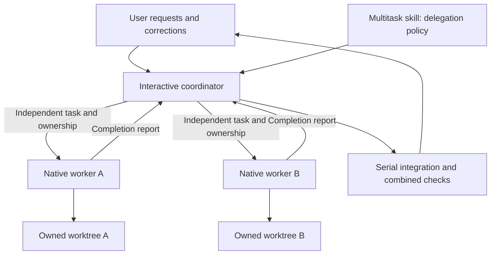

# A Cursor-style multitask workflow for Claude Code

**Recommendation: use one interactive Claude Code coordinator, native background subagents, and a small reusable delegation skill.** Keep a custom CLI scheduler as a later option for an application that needs to own its user interface and recovery queue.

This adapts the [Cursor multitask research](../cursor-multitask/README.md) into a proposed Claude workflow. It is a design and adoption plan, with untested configuration templates. Nothing was installed or executed against a model. Research date: **October 19, 2026**; locally inspected CLI: **Claude Code 2.1.303**. [Evidence and sources](sources.md)

For an application that runs Claude CLI, the [native task UI specification](native-task-ui-spec.md) describes creating a progress list for every query and updating a custom card from confirmed `TaskCreate`/`TaskUpdate` results in the JSON stream, without MCP.

The [context usage tracking specification](context-usage-tracking-spec.md) describes a context meter using native SDK summaries with a raw CLI fallback, including refresh rules, compaction, stale readings, and acceptance tests.

## What transfers from Cursor

Cursor's useful pattern is organizational: keep one conversation responsible for the user's goals, hand substantial work to a worker, and bring results back for integration. Reproduce that relationship before reproducing implementation machinery.

| Cursor research concept | Claude adaptation | Responsibility |
|---|---|---|
| `/multitask` coordinator instructions | Proposed user-invoked `multitask` skill | Keep objectives, dependencies, and next decisions visible |
| Background task | Native background subagent | Perform one coherent assigned outcome |
| Handoff of existing work | User-invoked `/subtask`, or an explicit context summary | Preserve relevant reasoning without recursive delegation |
| Completion-triggered follow-up | Native subagent completion delivery | Review the report and decide the next action |
| Workspace ownership | Explicit file ownership and worktree policy | Prevent competing changes; integrate serially |
| Independent whole session | CLI `--bg` | Separate operational workflow, with its own lifecycle |

Claude already documents background execution, return-to-caller results, inherited-history `/subtask`, nested subagents, and peer messaging. Those capabilities do not require agent teams. Consequently, a missing scheduler is not the starting problem. [Subagents](https://code.claude.com/docs/en/sub-agents)

## Proposed architecture

Start with one worker per request. Add a sibling only when the outcomes are independent. A short task ledger should identify each request, its owner, dependencies, and acceptance check. These are proposed team conventions; prompts do not enforce locks or create durable scheduler state.

The coordinator can finish its foreground response after dispatch, then incorporate subsequent user corrections and worker results. Its completion report must distinguish “worker finished” from “changes integrated and checked.” A cancellation ends that task until the user requests another attempt.

## Choose context, filesystem, and lifetime separately

A conversation handoff decides what the worker knows. A worktree decides which files it can change independently. Background execution decides how the interaction proceeds. None substitutes for the others.

The skill template deliberately remains in the main conversation. Skill `context: fork` instead runs the skill in a fresh child context; it is not transcript inheritance. [Skills](https://code.claude.com/docs/en/skills)

An independent `--bg` session is useful when the whole job should have a separate lifecycle. With agent view enabled, `/fork` also creates a separate session whose result does not automatically return to the original conversation. [Agent view](https://code.claude.com/docs/en/agent-view)

## Adoption and evidence limits

Follow the [implementation plan](implementation-plan.md), review the [example skill](examples/.claude/skills/multitask/SKILL.md) and [worker](examples/.claude/agents/task-worker.md), then evaluate them in a disposable target repository. They are examples, not active configuration for this research repository.

Official documentation establishes advertised contracts; local help establishes available command surfaces. Neither proves this workflow succeeds in practice. Completion timing, interruption recovery, inherited context, and integration quality need the bounded trials in the plan. Preserve the existing Cursor evidence as a separate investigation; this adaptation does not claim access to Claude's internal implementation.

[Static verification](verification.md) covers command syntax, template frontmatter, help excerpts, links, and publication hygiene. Live Claude workloads remain untested.
