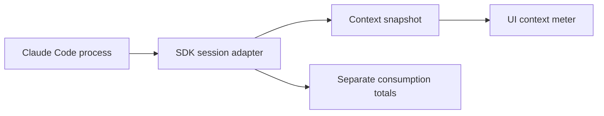

# Claude CLI Context Usage Tracking Spec

Build a context meter for a custom application backed by Claude Code CLI. Use the TypeScript Agent SDK’s native context summary as the primary source, with a last-request estimate for integrations that must remain raw CLI wrappers. Keep context occupancy separate from token consumption and account limits.

The proposed UI shows Claude’s reported context percentage, when it was refreshed, and whether the value is estimated or stale. It must remain useful through tool calls, compaction, resume, model changes, and subprocess restarts.

## Recommended integration

Place a small adapter in the application backend between the UI and the existing Claude session. Prefer the public Agent SDK over implementing Claude’s internal control protocol yourself. The SDK remains backed by a Claude Code process.

Use `query.getContextUsage({ detail: "summary" })` for routine updates. The method was introduced in SDK 0.2.86; summary mode arrived in 0.3.257. Summary combines response usage with local estimates and avoids the per-category token-count API calls of a full breakdown. Always pass `detail: "summary"` explicitly. [Anthropic SDK changelog](https://github.com/anthropics/claude-agent-sdk-typescript/blob/main/CHANGELOG.md)

Require SDK 0.3.257 or later and a verified compatible CLI before enabling automatic summary refreshes. Checking only whether the method exists is insufficient: older implementations may ignore the options and run a full breakdown.

Keep the SDK query and its input stream alive while the conversation is open. A process that exits after each prompt cannot answer subsequent control requests. If the app already launches one process per turn, verify refresh timing while that process is alive, before iterator exhaustion or process exit, and retain the last snapshot between turns; moving to a persistent session can be a separate change.

Assumptions: the application controls its local or server-side Claude process, can receive structured output, and has a backend capable of running the TypeScript SDK. Existing permissions and authentication remain owned by that integration.



## Data sources and priority

| Integration | Preferred source | UI meaning |
| --- | --- | --- |
| CLI through Agent SDK | Native summary query | Claude-reported context estimate |
| Raw CLI with stream JSON | Latest main-session request input usage | Last request context |
| Interactive CLI inside a terminal | Status-line JSON bridge, if already supported | Last reported context |
| No usable telemetry | No numeric value | Context unavailable |

A fresh native summary supersedes a fallback snapshot for the same session and conversation generation. Retain its source so the UI never silently changes the meaning of a number.

The published SDK exposes summary fields including `totalTokens`, `maxTokens`, `rawMaxTokens`, `percentage`, `model`, `categories`, and `isAutoCompactEnabled`. Use the returned percentage. The declarations do not fully specify the distinction between the two maximum fields or the units of `autoCompactThreshold`; do not derive a countdown from them. [Anthropic SDK declarations for 0.3.301](https://app.unpkg.com/@anthropic-ai/claude-agent-sdk@0.3.301/files/sdk.d.ts)

Treat “context budget” and “model capacity” as separate concepts. The installed CLI’s `--help` on October 19, 2026 reports an `--autocompact` setting, so the application must support a compaction policy that differs from the model’s capacity. Do not hardcode a 200,000-token denominator or a universal compaction percentage.

## Backend contract

Maintain one current snapshot per session and main agent. Use the application’s existing state store and transport.

```ts
type ContextSnapshot = {
  sessionId: string;
  processGeneration: number;
  contextGeneration: number;
  revision: number;
  observedAt: string;
  model: string | null;
  source: "native-summary" | "last-request" | "statusline";
  state: "ready" | "refreshing" | "stale" | "unavailable";
  accuracy: "estimated" | "last-request";
  tokens: number | null;
  percentage: number | null;
  denominatorKind: "native-budget" | "model-capacity" | "unknown";
  capacityTokens: number | null;
};
```

These are application fields, not a claimed SDK response type. Keep the original native maximum fields in diagnostic state until their semantics have been verified against the supported SDK and CLI versions. Only populate `capacityTokens` from a verified capacity for the current model and configuration. A native percentage can be displayed without inventing a numeric denominator.

Validate incoming values as finite and nonnegative; preserve null as unknown. Reject malformed samples without discarding the previous valid snapshot. Do not convert missing usage to zero. Allow valid readings above 100%; clamp only the drawn progress bar.

Keep refresh errors local to telemetry. They must not interrupt generation, alter permissions, or abort the underlying query. Send the frontend only the fields it needs; diagnostics should omit prompts, tool results, file contents, and credentials.

## Refresh and lifecycle rules

Request a summary when the process is initialized and usable, after a completed turn, after compaction, and after a model change. During active work, schedule refreshes from message and tool activity, coalesced to at most one request per second. This cadence is a proposed application policy, to be checked for latency against the supported runtime.

Allow only one summary request in flight. Record a dirty flag if another refresh is needed, then run one replacement refresh when the current request completes. Give telemetry a five-second UI deadline: show stale data on timeout, and ignore a late response when its generation no longer matches. If a request remains unresolved after the deadline, mark native telemetry degraded and use stream fallback. Do not launch overlapping native requests; resume native refresh after that request settles or a new process generation starts. Do not restart or cancel the agent to recover telemetry.

| Event | Required state transition |
| --- | --- |
| New session | Start with unknown usage; request a summary |
| Tool output or new input after fallback sample | Mark the fallback sample stale until the next measured request |
| Compaction begins | Show “Compacting” if the lifecycle event is available |
| Compaction completes | Increment context generation; invalidate the old sample and request a new summary |
| Model or compaction policy changes | Increment context generation; invalidate the previous percentage and denominator; refresh |
| Resume or subprocess restart | Increment process generation; display any retained sample as stale until refreshed |
| Clear or new conversation | Increment context generation; remove the prior conversation’s snapshot |
| Process exit or telemetry failure | Keep the last sample with its timestamp and stale state |
| Session switch | Render only that session’s snapshot |

Assign each refresh a request sequence ID. Use it with monotonically increasing revisions and generation checks to reject superseded or out-of-order refresh completions. Do not infer compaction solely from a falling token count. The stream’s `system` event with subtype `compact_boundary` can identify a boundary; the next native summary establishes the new estimate.

## Fallback for raw CLI integrations

Continue using structured events if replacing the existing subprocess layer is out of scope. A supported launch shape is:

```sh
claude -p --input-format stream-json --output-format stream-json \
  --verbose --include-partial-messages
```

Use newline-delimited JSON parsing with a buffer for incomplete lines; keep stderr separate. The flags are documented in the [CLI reference](https://code.claude.com/docs/en/cli-reference). This command illustrates the event transport; the application’s existing input and permission handling are still required.

For completed assistant frames, read `frame.message.id` and `frame.message.usage`, filtering out frames with a non-null `frame.parent_tool_use_id`. For partial `stream_event` frames, obtain the ID and initial usage from `frame.event.message` on `message_start`; associate subsequent `message_delta.usage` with that active main-response ID.

A missing usage object or required `input_tokens` means unknown. Optional cache fields may default to zero only when their absence has that meaning in the verified provider schema. Explicit null or malformed values must not silently become zero.

For each main-session API response, capture its ID and input usage. Compute:

```text
lastRequestTokens =
  input_tokens
  + cache_creation_input_tokens
  + cache_read_input_tokens
```

Cache hits still occupy context. This formula follows the status-line numerator and excludes output tokens. It measures the last request, so label it “Last request context.” Use a percentage only when the current model capacity is independently known; label that denominator “of model capacity.” [Status-line context fields](https://code.claude.com/docs/en/statusline#context-window-fields)

Implement these accounting rules:

- Deduplicate repeated assistant blocks by API message ID within the session and agent. Never add their input usage together.

- Track only main-session requests in the main meter. Subagent activity needs its own attribution; do not add child context windows to the parent.

- Merge only fields actually present in a streaming usage update. Output-only updates must preserve previously received input and cache counts.

- Replace cumulative output counts for the same response instead of adding them. Do not add output tokens to the primary fallback numerator.

- Prefer the newest valid request snapshot, not the largest one ever observed. Compaction legitimately reduces usage.

Assistant events can repeat an API message across content blocks, and their output usage is not a final output total. Streaming usage updates are cumulative within a response. These constraints come from [Agent SDK cost tracking](https://code.claude.com/docs/en/agent-sdk/cost-tracking), [SDK streaming output](https://code.claude.com/docs/en/agent-sdk/streaming-output), and [API streaming semantics](https://platform.claude.com/docs/en/build-with-claude/streaming).

Do not scrape ANSI terminal output or periodically submit `/context` as a heartbeat. The public SDK method is the preferred control interface. An existing raw control-protocol adapter can support native summaries only behind explicit compatibility tests.

For a terminal-based application, a status-line script can forward JSON to an application-owned local channel. Keep that optional: the official documentation does not establish status-line execution as a headless `-p` contract. Hooks can signal compaction, but their documented payloads do not provide before-and-after token counts. [Status-line integration](https://code.claude.com/docs/en/statusline), [Compaction hooks](https://code.claude.com/docs/en/hooks#postcompact)

## User interface

Place a compact meter beside the active model or composer. Example values are illustrative.

| State | Display |
| --- | --- |
| Native summary | “Context 42%” with “83k estimated tokens” in details |
| Refresh in progress | Retain the previous reading with a subtle updating indicator |
| Raw fallback | “Last request 83k tokens”; show a capacity percentage only when known |
| Stale | “Context 42% · last updated 20s ago” |
| Compaction | “Compacting context…” |
| No sample | “Context unavailable” |

For native summaries, the tooltip should say: “Claude’s estimate against its current context budget. This can differ from the model’s maximum capacity.” Display the source and observation time in details. Do not call the estimate exact or describe the remaining percentage as a guaranteed number of messages or tokens before compaction.

Use neutral styling for ordinary usage and an advisory warning at 85% as an initial product choice. This warning is not a claim about Claude’s automatic compaction threshold. Do not interrupt work or compact automatically just because the UI threshold is crossed. Use text as well as color, and avoid announcing every streamed change to screen readers.

When the user opens a breakdown, optionally request `getContextUsage({ detail: "full" })`. Cache it until context changes; do not refresh it continuously. Keep categories marked as used, free, buffer, or deferred distinct rather than summing every returned category as occupied context. The SDK also exposes a separate structured `/context` response with different field names; do not parse it as the summary response. [Published SDK types](https://app.unpkg.com/@anthropic-ai/claude-agent-sdk@0.3.301/files/sdk.d.ts)

## Keep consumption separate

Context is the conversation state available to a model request. Consumption is the work paid for or charged over repeated requests. Show cumulative tokens and estimated cost in a separate usage panel, if the app already provides one.

Result aggregates must never drive the context meter. Their scope differs by field and runtime version, so define accounting boundaries separately and replace cumulative totals instead of summing repeated results. Account subscription limits are another metric and cannot be reconstructed from context occupancy. [SDK usage accounting](https://code.claude.com/docs/en/agent-sdk/cost-tracking)

## Delivery and acceptance criteria

Implement the smallest complete version in this order:

1. Add the SDK summary adapter, validated snapshot, and event-driven refresh.

2. Add the meter, unknown and stale states, and session isolation.

3. Support compaction, model changes, and restart/resume generations.

4. Add raw-stream fallback only if the app must support that integration.

5. Add an on-demand category breakdown after the basic meter passes verification.

Use fixture-based tests for the reducer and a small integration smoke test against the supported CLI and SDK versions.

| Test | Pass condition |
| --- | --- |
| Missing usage | UI shows unavailable, never 0% by substitution |
| Cached request | 1k input + 9k cache creation + 40k cache read yields 50k tokens |
| Repeated assistant blocks | The same API message leaves occupancy unchanged |
| Partial output usage | Output counts of 10 then 25 yield 25; input fields remain intact |
| Multiple tool cycles | Meter follows the latest request instead of accumulated input |
| Child agent activity | Main meter is not replaced by child usage |
| Compaction | Old sample is invalidated; a lower refreshed estimate is accepted |
| Late refresh after reset | Old response cannot overwrite the new conversation |
| Model or policy switch | No percentage is rendered using a stale denominator |
| Telemetry timeout | Chat continues and the last sample becomes stale |
| Reading above 100% | Numeric value is preserved; visual bar remains bounded |
| Process resume | First displayed retained sample is explicitly stale |
| Native summary | Works on the same live session used for chat without sending a conversational prompt |
| Upgrade | Recorded event fixtures and summary shape pass before changing the supported version pair |

Release gate: validate summary availability, refresh behavior during a turn, and denominator semantics against the exact SDK and CLI pair. The local CLI reports 2.1.303; the published declaration reference used here is SDK 0.3.301. This spec does not assert that their interoperability has been runtime-tested. Pin a verified pair, and fall back to last-request context when native telemetry is unavailable.
