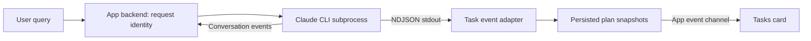

# Native Claude tasks in a custom progress UI

Use Claude Code's native `TaskCreate` and `TaskUpdate` tools, consume their results from the CLI JSON stream, and maintain an application-owned progress card. No MCP server is required.

**Status:** proposed, untested integration. **Research date:** October 19, 2026. **Locally inspected CLI:** Claude Code 2.1.303. Inspired by the supplied screenshot, this specification uses documented native CLI tasks to produce a similar checklist. It does not establish Claude Desktop's internal implementation. No model workload or end-to-end UI trial was run. [Existing evidence and sources](sources.md), [specification verification](native-task-ui-verification.md)

## Scope and ownership

Every user query gets a new progress card, including simple questions, which get one task. The application creates an empty card immediately; Claude supplies the task labels and lifecycle updates. Native tasks record progress, but do not execute the described work. [Task tracking](https://code.claude.com/docs/en/agent-sdk/todo-tracking)



The backend owns process lifecycle, event parsing, persistence, and request isolation. Claude owns the proposed steps and reported completion. The UI reads committed snapshots; it never infers task completion from prose, process exit, or a spinner ending.

## Launch configuration

For each new query, allocate a host-generated `requestId` and unique `taskListId`. Persist their association before starting the subprocess. Set these values in that subprocess's environment:

```text
CLAUDE_CODE_ENABLE_TODO_TOOLS=1
CLAUDE_CODE_ENABLE_TASKS=1
CLAUDE_CODE_TASK_LIST_ID=<taskListId>
```

The first two settings expose native task tools in non-interactive use. `CLAUDE_CODE_TASK_LIST_ID` selects the task list, allowing the app to isolate one query's checklist from another. Do not use a shared list for unrelated requests. Verify effective configuration because settings-file environment values can override inherited values. Confirm the interaction between an explicit list ID and `--resume` in the acceptance trials for the pinned CLI version. This design starts a fresh process per query; do not assume a long-lived process can switch lists per input. [Tool availability](https://code.claude.com/docs/en/tools-reference#task-tool-availability), [Task lists](https://code.claude.com/docs/en/interactive-mode#task-list)

Launch with a subprocess argument array, not a shell-interpolated command:

```ts
const args = [
  "-p", userPrompt,
  "--output-format", "stream-json",
  "--verbose",
  "--append-system-prompt", TASK_POLICY,
];
if (sessionId) args.push("--resume", sessionId);
// spawn("claude", args, { env: { ...process.env, ...taskEnvironment } });
```

Capture the Claude session ID from the stream and use `--resume <session-id>` on later queries in the same conversation. Those queries still get fresh app request and task-list IDs. Continuing an interrupted instance of the *same* query reuses its original list ID and persisted state. Optional `--include-partial-messages` enables incremental conversation text; it is not required to commit task updates. Keep stderr separate from stdout. [CLI reference](https://code.claude.com/docs/en/cli-reference)

## Create a list at the start of every query

Immediately after accepting input, publish a card with zero items, run state `planning`, and the label **Planning…**. This makes the card appear deterministically before Claude responds. It does not imply that Claude has created a task yet.

Append a stable policy on every subprocess invocation:

```text
For every user query, maintain the visible checklist with TaskCreate
and TaskUpdate. This includes simple questions: create one task for them.

Before substantive work, create a concise ordered list of the steps
needed for this query using TaskCreate. Use short imperative subjects
and useful activeForm labels. Finish creating the initial list, then
mark exactly one task in_progress using TaskUpdate.

Use TaskUpdate as work progresses. Mark a task completed only after
its work is finished; then mark the next task in_progress. Keep at most
one task in_progress. Revise the tasks when the actual work changes.
Before answering, ensure their statuses reflect the actual outcome.

Use the current task list only for this query. Do not reuse task IDs
from previous queries. When explicitly continuing an interrupted query,
inspect its existing tasks and continue them without creating duplicates.
The main agent owns this checklist; subagents must not update it.
Do not duplicate the checklist as a numbered plan in your prose.
```

Keep this policy stable across resumed invocations: resume may restore the system-prompt snapshot, so changing appended instructions is not a reliable way to pass per-query state. Bind request identity in the host and use the user prompt to distinguish a new query from continuing an interrupted one. Deliberate policy changes require testing the documented snapshot controls or using an appropriate prompt hook. [CLI reference](https://code.claude.com/docs/en/cli-reference)

The card fills progressively as successful `TaskCreate` results arrive. There is no native “initial plan complete” event. The first confirmed `in_progress` update moves the card out of `planning`; this is an app convention, not proof that Claude has finished planning.

Prompting encourages early task creation but cannot guarantee it. If ordering must be enforced, optionally add a `PreToolUse` gate that blocks substantive work tools until the host has confirmed at least one created task and one active task for the request. Allow task-management calls through; return an actionable denial explaining the missing progress state. Fail closed when the gate cannot read request state. This requires a host state channel and hook configuration, but no MCP. [PreToolUse hooks](https://code.claude.com/docs/en/hooks#pretooluse)

That gate cannot establish that the *whole* initial plan is final, and cannot prevent an answer containing no work-tool call. Acceptance policy must define what to do when Claude answers without creating tasks: show “No task plan reported,” preserve the answer, and record the noncompliance. Do not invent model-authored tasks after the fact. Strict guarantees for every answer would require a separate host-controlled planning phase beyond this design.

## JSON stream adapter

Parse stdout as newline-delimited JSON (NDJSON). Buffer incomplete lines across byte chunks, handle multiple records per chunk, and process complete records in order. A chunk boundary is not an event boundary. Preserve a final nonempty buffered record on EOF only if it parses completely; otherwise record a truncated-stream error.

Recognize complete root assistant `tool_use` blocks for `TaskCreate` and `TaskUpdate`. Store their inputs in a pending map by `(runId, tool_use_id)`. Only root messages with `parent_tool_use_id` null or absent can affect the displayed checklist. Do not merge subagent tools or background-task notifications into the card. [Task tracking and streamed messages](https://code.claude.com/docs/en/agent-sdk/todo-tracking)

Filtering child events does not prevent subagents from mutating a shared native task list. The baseline prohibits subagent task mutations. If subagents are enabled, enforce that rule with a hook using `agent_id`, or assign independently executing agents separate task lists. Without enforcement, isolation remains unverified and a root `TaskList` result may include child changes.

Pair each call with the corresponding `user` message's `tool_result` block using `tool_use_id`. Commit only after a successful result. For creation, obtain the assigned task ID from the structured result at `message.tool_use_result.task.id`; never generate an ID or infer one from the requested subject. Here `message` means the parsed stream event, not its nested conversation payload. Preserve raw events when the actual CLI envelope differs from the documented SDK example and mark that operation for reconciliation.

Normalize task fields at the adapter boundary. In raw tool inputs, accept `id` or `task_id` as aliases for `taskId`, and `active_form` as an alias for `activeForm`: Claude CLI repairs these names before execution. The documented update result uses canonical `taskId`. Keep unknown or conflicting fields in raw receipts rather than silently mapping ambiguous values.

| Confirmed operation | Committed UI change |
|---|---|
| `TaskCreate` succeeds with assigned ID | Add a pending item with subject, active form, and creation order |
| `TaskUpdate` succeeds with `pending` | Show the neutral pending marker |
| `TaskUpdate` succeeds with `in_progress` | Show the running indicator while the run remains active |
| `TaskUpdate` succeeds with `completed` | Show a checkmark and increment the completed count |
| `TaskUpdate` succeeds with `deleted` | Remove the item and its contribution to both counts |
| Subject or active form update succeeds | Replace only label fields confirmed by authoritative output or `updatedFields` |
| Tool result reports an error | Leave the prior snapshot unchanged; retain the failure receipt |

A result without `is_error` is not sufficient. The documented `TaskUpdate` output contains `success`, `taskId`, `updatedFields`, `error`, and optional `statusChange: {from, to}`. Require `success === true`, no tool-result error, and a matching task ID. For ordinary status changes, use `statusChange.to`; use the requested status only when `updatedFields` confirms `status` changed. Otherwise preserve state and reconcile. For deletion, a matching successful result for requested status `deleted` removes the item; corroborate any returned status change without requiring an undocumented exact deletion payload. [TaskUpdate output](https://code.claude.com/docs/en/agent-sdk/python#taskupdate)

Prefer the returned subject when creating a task. This baseline assumes hooks do not rewrite task inputs: raw streamed input may otherwise differ from executed input, requiring authoritative output or reconciliation. Unknown result shapes, missing assigned IDs, unknown task IDs, and contradictory results mark the plan `dirty`; do not fabricate a successful mutation.

For subject and active-form updates, apply the requested field value only if `updatedFields` confirms that field changed; prefer an authoritative returned value when supplied. A successful update to one field does not confirm every requested field changed.

The adapter may ingest successful root `TaskList` and `TaskGet` results for reconciliation. `TaskList` returns IDs, subjects, statuses, optional owners, and blockers; it does not guarantee active-form or description fields. These are model tools, not a standalone `claude tasks list` command: obtaining a missing result may require another model invocation and its associated cost. Restore ordinary UI refreshes from app persistence. Do not depend on undocumented on-disk task JSON or resend a mutating call merely because the app missed its result. [TaskList output](https://code.claude.com/docs/en/agent-sdk/python#tasklist)

A successful, complete `TaskList` result bound to the current isolated `taskListId` is authoritative for membership, subjects, and statuses. Reconcile those fields, preserve local active forms and display order for surviving IDs, and append newly discovered IDs in stable result order. Clear `dirty` only when reconciliation resolves the uncertainty. An incomplete or ambiguously bound result stays dirty and must never delete unseen tasks.

Ignore incremental tool argument fragments for state mutation. If partial events are enabled, use them only for text animation or diagnostics. Deduplicate confirmed operations by `(runId, tool_use_id)` so replayed assistant/result records cannot add duplicate tasks or repeat updates.

## Worked event flow

These fragments illustrate relevant fields only; they are not complete captured CLI records. Validate the envelope and result fields with the pinned executable before implementation.

```json
{"type":"assistant","parent_tool_use_id":null,"message":{"content":[{"type":"tool_use","id":"c1","name":"TaskCreate","input":{"subject":"Alpha","description":"Complete the first planned step.","activeForm":"Working on Alpha"}}]}}
{"type":"user","parent_tool_use_id":null,"message":{"content":[{"type":"tool_result","tool_use_id":"c1","is_error":false} ]},"tool_use_result":{"task":{"id":"1","subject":"Alpha"}}}
{"type":"assistant","parent_tool_use_id":null,"message":{"content":[{"type":"tool_use","id":"c2","name":"TaskCreate","input":{"subject":"Beta","description":"Complete the second planned step.","activeForm":"Working on Beta"}}]}}
{"type":"user","parent_tool_use_id":null,"message":{"content":[{"type":"tool_result","tool_use_id":"c2","is_error":false} ]},"tool_use_result":{"task":{"id":"2","subject":"Beta"}}}
```

After those successes, the UI contains two pending items and shows `0 / 2`. Confirmed updates produce this sequence:

| Successful `TaskUpdate` input | Alpha | Beta | Counter |
|---|---|---|---|
| `{"taskId":"1","status":"in_progress"}` | Spinner | Pending | `0 / 2` |
| `{"taskId":"1","status":"completed"}` | Checkmark | Pending | `1 / 2` |
| `{"taskId":"2","status":"in_progress"}` | Checkmark | Spinner | `1 / 2` |
| `{"taskId":"2","status":"completed"}` | Checkmark | Checkmark | `2 / 2` |

Use the same call/result pairing for each update. The third row reproduces the screenshot's progress state.

## Persisted state and UI delivery

```ts
type TaskItem = {
  id: string;
  subject: string;
  activeForm?: string;
  status: "pending" | "in_progress" | "completed";
  order: number;
};
type PlanSnapshot = {
  conversationId: string;
  requestId: string;
  taskListId: string;
  revision: number;
  items: TaskItem[];
  runState: "planning" | "running" | "finished" | "interrupted" | "failed";
  dirty: boolean;
};
```

Key tasks by `(requestId, taskId)`: task IDs are not globally unique. Store a separate run record with `runId`, Claude session ID, pending call correlations, and deduplication receipts. Persist the accepted event receipt and new snapshot atomically, incrementing `revision` for each state change, then publish over the app's existing SSE or WebSocket channel.

On refresh or reconnect, fetch the latest snapshot and subscribe to newer revisions. Ignore older or duplicate revisions. Event receipt retention must cover the replay window; replaying an old stream must not mutate an already restored plan twice.

Render a collapsible **Tasks** card. The header shows completed items divided by total undeleted items. Use a neutral marker for pending tasks, a spinner for active tasks during a live run, and a checkmark with muted text for completed tasks. Use `subject` for stable labels; `activeForm` may supply a live activity caption. Preserve creation order rather than sorting by status.

If Claude marks multiple items active, display the reported state and record a policy violation; do not silently complete or demote a task. An optional hook can reject such updates before execution if this invariant must be enforced.

## Request lifecycle and recovery

- **New query:** allocate a new request and task-list ID even when resuming the same Claude conversation; create a new `Planning…` card.
- **Same interrupted query:** reuse its identifiers, inspect existing native tasks, and continue with a new `runId`; do not blindly recreate the plan.
- **User steering during work:** serialize the new query behind the current run, or stop and drain the old subprocess before starting its replacement. Bind every stream reader to the original request ID so late records cannot modify the new card.
- **Final result:** update the run state, but never mark outstanding tasks completed automatically. A final answer can coexist with an incomplete checklist.
- **Cancellation or crash:** stop the animation through `runState`, retain each task's last confirmed status, and label the run interrupted or failed.
- **Missing or uncertain events:** retain the last trusted snapshot, mark it dirty, and reconcile through verified native task results when execution resumes.

Fresh task-list IDs prevent native storage sharing across queries. They do not prevent the resumed model from remembering old IDs in conversation history; the policy and invalid-ID handling remain necessary. Test resumed-session selection rather than assuming environment precedence. [Task lists](https://code.claude.com/docs/en/interactive-mode#task-list), [CLI resume](https://code.claude.com/docs/en/cli-reference)

## Acceptance checks before shipping

| Trial | Required outcome |
|---|---|
| Two-step successful query | Early card; two confirmed creates; one active item; `0 / 2` → `1 / 2` → `2 / 2` |
| Simple conversational query | One task is created and completed under the every-query policy |
| Failed create or update | No speculative insertion or status change |
| Result confirms no mutation | Prior state remains; adapter reports or reconciles the mismatch |
| Fragmented/replayed NDJSON | Same final snapshot as uninterrupted input; no duplicate items or receipts |
| Delete a completed or pending task | Item and appropriate numerator/denominator contributions disappear |
| Root and subagent task events | Only root events change the visible plan |
| New query using `--resume` | Fresh task-list ID is honored and prior query tasks remain isolated |
| Resume interrupted query | Original list is retained and existing task IDs are reused correctly |
| Cancel, crash, refresh, reconnect | Last committed steps persist; spinner stops; snapshot recovery works |
| Late events after steering | Events remain attached to the old request |
| Unknown ID or result schema | Plan becomes dirty; no guessed mutation; reconciliation is observable |
| Prompt fails to create a plan | Explicit “No task plan reported”; optional work-tool gate behaves as specified |

Pin the tested CLI version and save sanitized stream fixtures covering creates, updates, deletes, failures, root/subagent envelopes, and resume behavior. Published documentation supplies the intended API contract; these trials must establish the executable's actual event shapes and ordering before the integration is considered verified.
