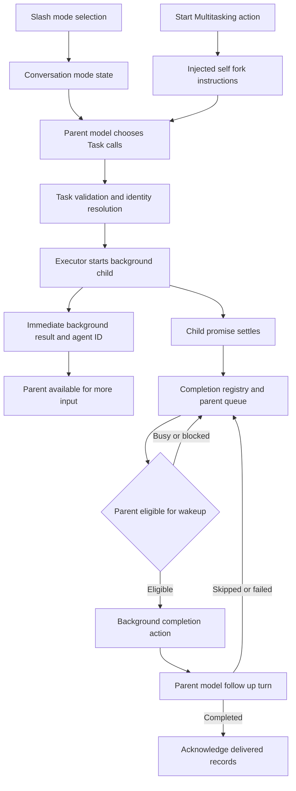

# How Cursor multitask works

Cursor’s `/multitask` makes the main agent a coordinator for background subagents. The parent delegates work, stays available for further requests, and receives completion events that can start another parent turn. The feature combines **mode state, instructions to the model, asynchronous execution, and a completion queue**. The model chooses the work breakdown within that machinery.

This report covers installed **Cursor 3.25.9 stable**, built October 15, 2026, and official documentation consulted October 19, 2026. Implementation findings come from shipped JavaScript, not an observed agent run. [Artifact identity](evidence/artifact-map.md) · [Methodology and REA evidence](methodology.md)

## The user workflow

Cursor introduced `/multitask` in the Agents Window in 3.2, then extended it to the editor in 3.3. It allows additional requests to proceed through asynchronous subagents instead of waiting for earlier work. **Build in Parallel** applies the same underlying capability to independent parts of a plan, while retaining dependency order. [Cursor 3.2](https://cursor.com/changelog/04-24-26) · [Cursor 3.3](https://cursor.com/changelog/05-07-26)

The installed code distinguishes two entry points:

1. **Select the Multitask mode through the slash menu.** The UI changes `unifiedMode`. Selecting the active mode again returns to ordinary Agent mode. This handler changes mode; it does not itself launch a child.
2. **Click Start Multitasking while work is underway or queued.** The UI force-submits a simulated message with reason `MULTITASK`. The runtime turns that reason into special instructions for handing the current task to a background worker. Submission failure restores the prior mode in the wrapper that changes it. [UI01–UI12](technical/ui-analysis.md)

Mode availability depends on the UI surface, project state and feature configuration. In the examined project-root branch, Start Multitasking can select ordinary Agent mode while still submitting the handoff action. Treat the action and the persistent mode as separate pieces of state. [UI03–UI10, UI25](technical/ui-analysis.md)

## The handoff of current work

The Start Multitasking reminder tells the parent to make **exactly one** Task call with `run_in_background: true` and `resume: "self"`. It supplies a continuation prompt telling the child to continue its existing task, and asks the parent to stop foreground work immediately afterward. That continuation wording also prevents a recursive chain of children each interpreting the same reminder as another instruction to fork. This is packaged prompt policy; it depends on the model following the instruction. [R01](technical/runtime-analysis.md)

`resume: "self"` is a special fork operation. In the inspected server preparation branch, it copies parent conversation state and defaults to all turns; in the client-executor branch, it passes the current conversation ID as `forkAgentId`. A fresh ordinary child instead receives its supplied task context, and `resume: childId` continues an existing child. A conversation fork does not establish an operating-system process fork or a separate Git checkout. [R07–R13, R17, R31–R33](technical/runtime-analysis.md)

## How it divides new requests

The persistent Multitask instructions favor **one coherent worker per nontrivial request**. They allow siblings when deliverables are independently useful or parallel exploration materially helps. Investigation, implementation and testing for one tightly coupled change usually remain together. The coordinator is instructed not to repeat delegated work or occupy its foreground turn with polling and waiting. Some model-specific wording is stricter about delegating even small tool-based tasks. [R03–R06](technical/runtime-analysis.md)

Build in Parallel has a distinct policy: form phases from plan dependencies, start independent phases concurrently, and test the combined implementation after parallel workers finish. The inspected instructions express this decomposition; they do not reveal a universal deterministic dependency scheduler. [R02](technical/runtime-analysis.md)

For example, “fix the login bug” normally stays with one worker that investigates, patches and tests. A separate request to update documentation can go to another worker while the first continues. This example illustrates the packaged policy; it is not a recorded run.

## Execution and completion

The diagram summarizes the inspected local/client paths. Feature gates and alternative host routes mean it is an architectural synthesis, not a trace of one execution.

The background executor obtains a local capacity slot, starts the child with an independent cancellation controller, registers its promise and returns immediately with an agent ID and background status. The return means dispatch succeeded; it does not mean the work is finished. A running foreground child also has a handoff path that removes its foreground cancellation linkage while retaining the execution promise. [UI13](technical/ui-analysis.md) · [H02](technical/host-analysis.md)

When the promise settles, lifecycle code records success, error or abortion and routes a completion toward its parent. In the examined Glass wakeup path, dispatch waits while the parent has a live turn, a blocking user decision or a questionnaire awaiting input. It also checks workspace ownership and suppresses archived conversations. [UI14–UI23](technical/ui-analysis.md)

Eligible results become a `backgroundTaskCompletionAction`. The runtime constructs simulated `BACKGROUND_TASK_COMPLETION` input and can run the parent model again. Delivery is acknowledged after a completed wakeup; skipped or failed attempts can be requeued. Feature gates, `recordOnly` events, cancellation and other filters can suppress a follow-up. These branches support retries, but do not prove exactly-once delivery or recovery after a process crash. [UI16–UI23](technical/ui-analysis.md) · [H03–H05](technical/host-analysis.md)

## Follow ups and stopping

Completed children can be resumed by ID. For a child still running, the Task interface ordinarily rejects a follow-up unless an enabled interrupt capability is used. The executor also contains queued-resume machinery, but a `QUEUED_FOLLOW_UP` result is converted to a tool error in the inspected Task path. Its enum name alone is not a promise that a user's message was accepted into a durable queue. [R13, R18, R28](technical/runtime-analysis.md) · [UI15](technical/ui-analysis.md)

Stopping the parent and ending its current turn are different events. Background dispatch can outlive the initiating tool call. Explicit parent cancellation reaches child cancellation registries, with exclusions for certain pending task resolutions. Therefore “every child always dies when the parent stops” is stronger than the observed implementation supports. The local host also includes an eight-second hard-cancel backstop after a normal abort request. [H11–H13](technical/host-analysis.md)

The queue-tray control tracks the first queued message until it appears in the conversation or disappears from the queue. Its click handler does not itself dequeue that message. The exact ordering of all queued messages through downstream forced submission remains unresolved. [UI11–UI12](technical/ui-analysis.md)

## Workspace isolation and limits

**Subagents share the parent checkout by default**, according to Cursor's current documentation. Explicit isolation can give a child its own worktree/branch or cloud environment. `/multitask` alone therefore does not promise collision-free filesystem work. Separate conversation context and separate filesystem state are different properties. [Subagents documentation](https://cursor.com/docs/subagents)

Multiple top-level chats, same-prompt candidate comparisons, worktrees and cloud agents are related but distinct capabilities. The historical eight-agent figure from Cursor 2.0 described candidate runs; it is not an established `/multitask` cap. [Cursor 2.0](https://cursor.com/changelog/2-0) · [Feature comparison](official-sources.md)

The inspected local executors have a configurable concurrency fallback of **32**. This is neither a launch target nor a verified product-wide limit. Task decomposition is prompt-driven, while capacity is enforced by executor configuration. Await has a 30-second default and a 119-minute schema ceiling, with runtime settings able to tighten it; Multitask policy usually asks the parent to yield instead of using that wait. [UI13, UI26–UI27](technical/ui-analysis.md) · [H01, H06–H10, H16](technical/host-analysis.md)

## Confidence and remaining questions

The mode/action distinction, fork arguments, asynchronous handoff, completion construction and retry branches are supported by exact shipped-source excerpts. Actual rollout flags, model compliance, complete queue ordering, task durability after restart, cloud lifecycle and cancellation races require runtime testing. The REA analysis is partial and its literal feature trace had no match; the source excerpts, not that trace, support the detailed feature claims. [Evidence limits](methodology.md) · [Finding ledger](findings.md)

## Files in this folder

- [Finding ledger](findings.md): questions, answers, evidence and confidence.
- [Runtime and prompt analysis](technical/runtime-analysis.md): fork/resume behavior, instructions, schemas and identity handling.
- [UI and completion analysis](technical/ui-analysis.md): mode controls, queues, background execution and parent wakeups.
- [Host lifecycle analysis](technical/host-analysis.md): capacity, waits, completion and cancellation.
- [Official sources](official-sources.md): dated product history and feature distinctions.
- [Methodology](methodology.md): reproducibility, REA IDs, scope and limitations.
- [Verification](verification.md): original local checks of 76 excerpts, artifact hashes, document links and retained evidence; public-copy checks are tracked separately.
- [Evidence folder](evidence): exact excerpts, public file hashes and redacted REA receipts. The original full export is retained locally and omitted from this repository.
